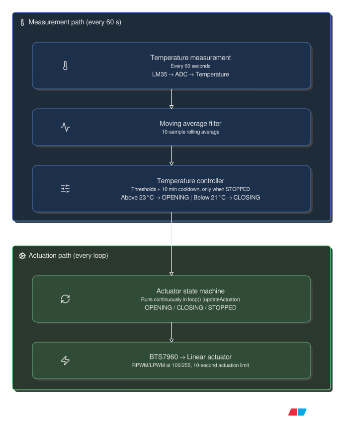
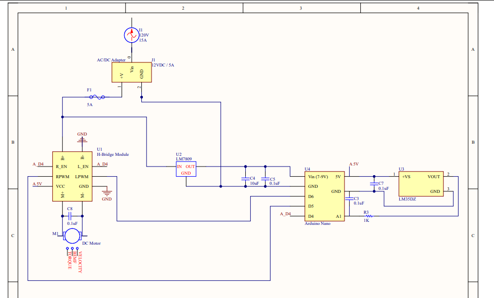

# Automated Climate-Controlled Window

An Arduino-based automated window control system that monitors ambient temperature and operates a 12V linear actuator to regulate indoor temperature.

## Overview

The system uses an LM35DZ temperature sensor to monitor room temperature. An Arduino processes sensor measurements using a circular moving average and controls a linear actuator through a BTS7960 H-bridge motor driver.

Temperature thresholds with hysteresis determine when the window opens or closes, while non-blocking timing allows the system to operate without interrupting sensor measurements.

## Hardware

| Component | Purpose |
|---|---|
| Arduino Uno | Main microcontroller |
| LM35DZ | Temperature sensing |
| BTS7960 | H-bridge motor driver |
| 12V linear actuator | Window actuation |
| 12V power supply | Actuator power |
| LM7809 | Voltage regulation |

## Firmware Features

- Temperature acquisition through the Arduino ADC
- 10-sample circular moving average filter
- Hysteresis-based temperature control
  - Above 23°C: Open window
  - Below 21°C: Close window
- Non-blocking actuator timing using `millis()`
- PWM motor control through the BTS7960

## System Architecture

## Hardware Design

TODO: Add photo/video of prototype & oscilloscope measurements
<!-- Add schematic and prototype photographs here -->

## Currently

- Creating 3D printed window mount
- Stress-testing multi-day continuous runtime of fully integrated prototype

## Future Improvements

- Add wireless temperature monitoring
- Convert prototype --> perf board / PCB
- Switch the LM35 for a sensor capable of measuring humidity & CO2

## Technologies

Arduino C++, embedded systems, PWM, ADC, H-bridge motor control, Altium Designer.
